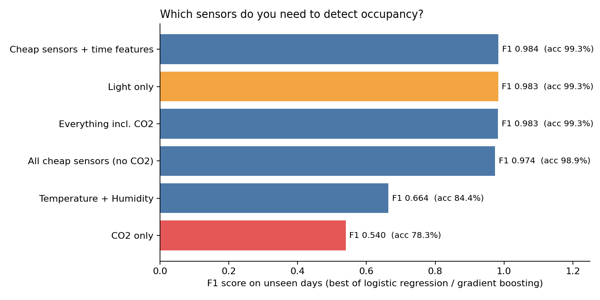
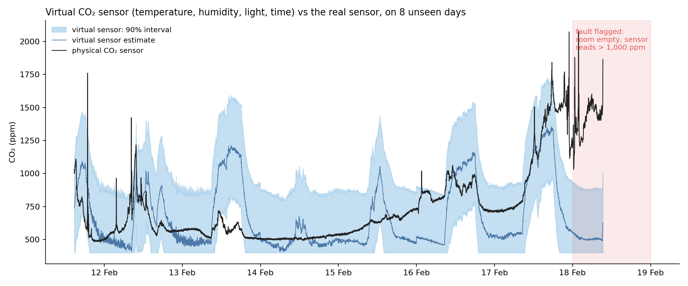

# Virtual CO₂ Sensor

**Can cheap sensors (temperature, humidity, light) replace a CO₂ sensor, for estimating air quality or for detecting whether a room is occupied? And can the model tell when the real sensor is wrong?**

Uses the [UCI Occupancy Detection dataset](https://archive.ics.uci.edu/dataset/357/occupancy+detection) (Candanedo & Feldheim, 2016): one office, one reading per minute, February 2015, with ground-truth occupancy. Training uses 2–10 Feb; **all results are on 11–18 Feb, days the models never saw.**

## Results

### 1. Occupancy: you don't need the CO₂ sensor


| Sensors used | Accuracy | F1 |
|---|---|---|
| **Light only** | **99.3%** | **0.983** |
| Cheap sensors + time features | 99.3% | 0.984 |
| Everything incl. CO₂ | 99.3% | 0.983 |
| Temperature + humidity | 84.4% | 0.664 |
| **CO₂ only** | 78.3% | 0.540 |
| *Always "empty" (no model)* | 79.0% | 0 |

A light sensor alone gives the same accuracy as all sensors combined. CO₂ on its own is barely better than always guessing "empty": it reacts slowly (it builds up over minutes) and stays high after people leave.

### 2. Virtual CO₂ sensor: honest uncertainty, and a fault detector


The model (linear regression on cheap sensors, time of day, and physics-inspired "accumulation" features: minutes of lights-on over the past 30–240 min) is wrapped in **split conformal prediction**, which turns any regressor into one with a 90% prediction interval calibrated on held-out data.

| Day | Empty-room CO₂ (ppm) | Readings inside the 90% interval | |
|---|---|---|---|
| 11–16 Feb | 485–697 | 71%–100% | ok |
| 17 Feb | 706 | 76% | ok |
| **18 Feb** | **1,031** | **0%** | **fault flagged** |

On 18 Feb the room is empty almost all day (1.6% occupied), yet the physical sensor reads 1,030–2,076 ppm. Outdoor air is ~400 ppm, so either **the CO₂ sensor drifted or the ventilation failed.** The virtual sensor, which only sees light, temperature and humidity, says the room should be near its normal level, and none of the readings fall inside its interval. Its disagreement is the alarm.

### 3. What doesn't work: exact ppm values (negative result)
| Model | MAE before the fault (ppm) | 90% interval half-width | Coverage on test days |
|---|---|---|---|
| Mean (no model) | 172 | ±944 | 98% |
| Linear regression | 175 | **±379** | 85% |
| Gradient boosting | 184 | ±405 | 85% |

Cheap sensors **cannot reconstruct the exact CO₂ value**: the point error is no better than always predicting the average. The model's value is a much tighter interval (±379 vs ±944 ppm), tight enough to catch the fault, which the "average" model's interval would miss. Coverage is 85% instead of the target 90% because the test week drifts away from the training weeks. Conformal guarantees assume the future looks like the calibration data, and here it doesn't quite.

## Reproduce
```bash
python -m venv .venv && .venv\Scripts\activate
pip install -r requirements.txt && pip install -e .
python -m vsensor.experiments     # downloads the data (~0.3 MB), prints all tables
python -m vsensor.plots
pytest
```

## Layout
```
src/vsensor/data.py         download, train/test split by date, time + accumulation features (past-only)
src/vsensor/conformal.py    split conformal prediction, from scratch (~30 lines)
src/vsensor/experiments.py  occupancy ablation, virtual CO2 sensor, per-day fault check
src/vsensor/plots.py        charts
tests/                      conformal coverage, no look-ahead in features
```

## Author
Hamza Fakhri, Computer Science engineering student, Polytech Nantes. Built on an idea from my 2024 internship on environmental sensor data: how many sensors do you really need?
